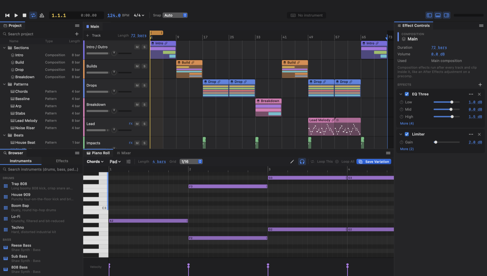
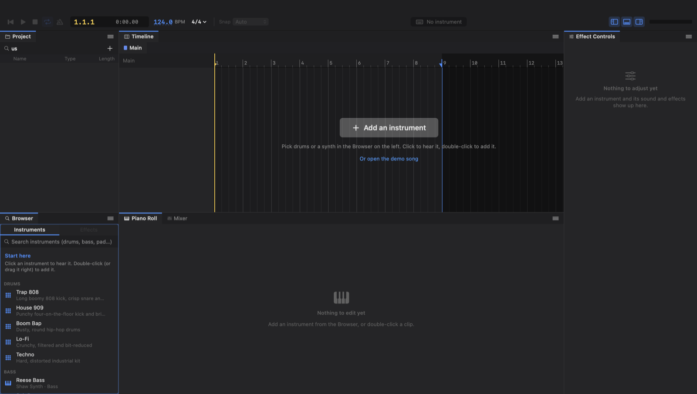
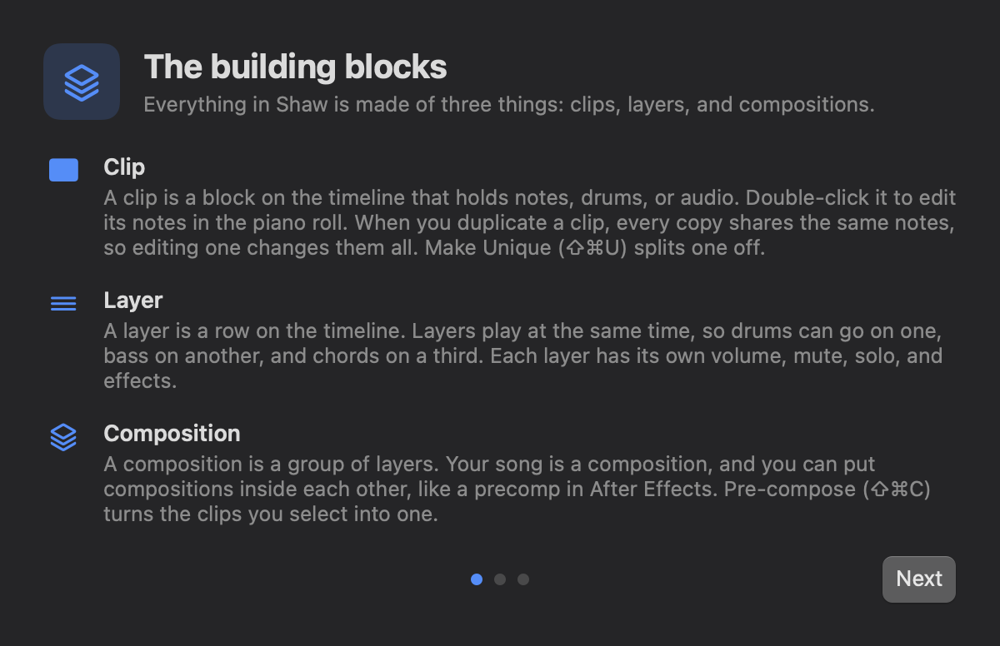
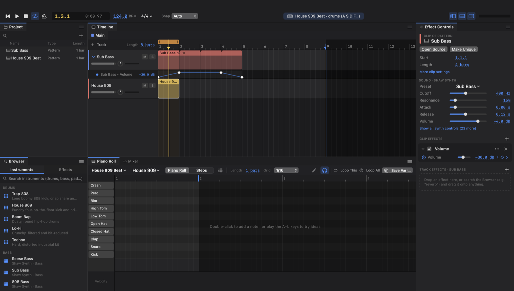

# Shaw

Shaw is a music app for the Mac that works like After Effects. I came from After Effects and Premiere, so I wanted compositions, linked clips, effects on anything, and keyframes, but for making music. It's also as simple as I could make it: you start with one button, and everything else shows up when you need it.



## The building blocks

- **Clip.** A block on the timeline that holds notes, drums, or audio. Double-click it to edit it. When you duplicate a clip, every copy shares the same notes.
- **Layer.** A row on the timeline. Layers play at the same time, and each one has its own volume, mute, solo, and effects.
- **Composition.** A group of layers or clips. Your song is a composition, and you can put compositions inside each other, like a precomp in After Effects.

## What's different

- **One timeline.** There's no separate session view. The orange loop bar at the top loops any part of the song, and opening a clip loops it.
- **Linked clips.** When you duplicate a clip, every copy shares the same notes. Edit one and they all change. Make Unique gives a copy its own notes, and Merge joins clips into one.
- **Compositions inside compositions.** Pre-compose a few clips and drop the result anywhere like a single clip, just like a precomp. An effect on a composition covers everything inside it, so one reverb can glue a whole drop together, one filter can sweep an entire intro, and one compressor can squash a drum group. Every place you use that composition gets the same treatment, and editing it once updates all of them.
- **Effects on anything.** Put effects on a clip, a layer, or a whole composition. Copy and paste them with ⌘C and ⌘V.
- **Keyframes.** Click a setting's stopwatch and change it over time. Diamonds show up under the layer, and you drag them around like in After Effects.
- **Variations without recording.** Tweak a loop while it plays, then Save Variation keeps that version and gives you a fresh copy right after it. Play them back to back when you're done.
- **Your keyboard is a piano.** The home row plays notes and Z / X change the octave. On drums, A is the kick and S is the snare.
- **Write melodies without the mouse.** Play the home row to try ideas, move the cursor with the arrow keys, and press Return to add a note. ⇧ and the arrow keys draw a box to select notes, and the arrow keys move them.

## Install

Download `Shaw.zip` from the [releases page](../../releases), unzip it, and drag Shaw into Applications. It runs on macOS 14 (Sonoma) or newer, on Apple Silicon and Intel.

Shaw isn't signed with an Apple developer account, so macOS blocks it the first time. Open it once, then go to System Settings, Privacy & Security, and click **Open Anyway**.

## Build it yourself

You need Xcode (the beta works too).

```sh
scripts/build-app.sh      # builds build/Shaw.app
open build/Shaw.app
scripts/package.sh        # builds a universal build/Shaw.zip to share
swift test                # runs the tests
```

## Getting started

New projects start empty with one button: **Add an instrument**. Pick drums or a synth in the Browser on the left. Click one to hear it, and double-click it to add it. Shaw makes a layer with a one-bar pattern, opens it in the piano roll, and loops it. Press Space and start adding notes.

To hear what a full song looks like, open **File → Open Demo Song**. There are three short ones, each about a minute long:

- **Starlight FM** is UK garage and future house in C minor at 134 BPM. It has a skippy 2-step beat, a bouncy bassline, pumping garage chords, and vocal chops with delay throws at the end of each phrase. Drop 2 puts the first drop inside it with a four-on-the-floor beat and a new topline.
- **Afterburn** is bass house in F♯ minor at 128 BPM. A call-and-response bass riff, "hey" chops, and rave stabs lead into a trap half-time switch-up where a growl bass and a riddim bass trade bars.
- **Lanterns** is melodic dubstep in E major at 140 BPM. Strings and a music box open into a half-time drop with huge pumping supersaws and a growl bass that switches wobble speed every two bars. Each speed is its own pattern with its own LFO setting. A glitchy, gated bridge leads into the last drop.



The first time you open Shaw, a short three-page guide walks through what's different. You can reopen it from the Help menu.



## Editing

**Timeline**
- Drag a clip to move it. Hold ⌘ to move it off the grid.
- Drag a clip's edge to trim it. Option-drag the right edge to loop it past its end.
- ⌘D duplicates a clip right after itself, and the copy stays linked.
- Double-click a clip to open it. Double-click an empty spot on a layer to draw a new pattern there.
- Right-click a clip for Fade In, Fade Out, Merge, Make Unique, and more.
- Click a layer's header and press Delete to remove the layer.

**Piano roll** (melodies and drums)
- Double-click to add a note, and double-click a note to delete it.
- Drag notes to move them, drag their right edge to resize them, and Option-drag to copy them.
- Drag across empty space to select notes. ⌘C, ⌘X, ⌘V, and ⌘D work on the selection.
- ⌥← and ⌥→ change note length. ↑ and ↓ transpose.
- Press B to switch to draw mode, where a single click adds a note.
- Drum patterns can switch to a step grid with the **Steps** button.
- The arrow keys move a cursor, and Return adds a note there. Hold ⇧ and press a note key to add that note at the cursor's beat. The note keys on their own only play, so you can try ideas first. 1 to 5 set the length.
- ⇧ and the arrow keys draw a box that selects the notes inside it, and Tab and ⇧Tab select the next and previous note. The arrow keys move selected notes, ⌘ moves them a bar or an octave, and Esc goes back to the cursor. Press ? in the piano roll to see every key.

**Effects and keyframes**
- Search the Browser's Effects tab and drag an effect onto a clip, a layer header, or a composition tab.
- Each effect shows its main settings. Click **More** for the rest, or ✕ to delete it.
- Click an effect's name to select it. ⌘A selects every effect on that layer.
- Click the stopwatch next to a setting to start keyframing it. Every change at the playhead adds a diamond.



## Shortcuts

| Keys | What they do |
| --- | --- |
| Space | Play / stop |
| ⌘L / ⌘K | Loop / metronome |
| ⌘N / ⌘T | New composition / new layer |
| ⇧⌘P / ⇧⌘B | New pattern / new drum pattern |
| ⌘D / ⇧⌘D | Duplicate / save variation |
| ⌘E / ⌘J | Split at playhead / merge clips |
| ⇧⌘C / ⇧⌘U | Pre-compose / make unique |
| ⌘Z / ⇧⌘Z | Undo / redo |
| ⌘S / ⇧⌘E | Save / export WAV |
| ⌘= / ⌘- / ⌘0 | Zoom in / out / fit |
| A–' · Z/X · C/V | Play notes · octave · velocity |

## What's inside

- **Shaw Synth**, a polyphonic synth with up to four oscillators, a sub, noise, supersaw-style unison, FM with its own envelope, analog drift, four filter types, envelopes, a tempo-synced LFO with six shapes, glide, and drive. It comes with 55 presets, including FM electric pianos and bells, plus Future Bass, Dubstep & Bass House, and Hyperpop sounds. Presets bring their own effects, like a sidechain pump and reverb on Future Chords.
- **Instrument Editor and My Instruments.** Click Edit Instrument to see a sound as cards you can stack: sine, triangle, saw, and square waves, plus pictures of the filter and envelope. Change a preset and save it as your own, or click + under My Instruments to build one from scratch. Your instruments show up in the Browser in every project.
- **Eight drum kits**: Trap 808, House 909, Boom Bap, Lo-Fi, Techno, Electro, Drill, and a recorded Acoustic Kit. Shaw generates the electronic kits in code.
- **Ten real instruments**, recorded a few notes apart so each note sounds natural: Grand Piano, Upright Piano, FM Piano, Vibraphone, Concert Marimba, Kenyan Kalimba, Glockenspiel, Harp, Tenor Sax, and Pipe Organ. The Samples tab also has 14 hand percussion hits, like congas, cajon, shaker, and tambourine. They come from the [Versilian Community Sample Library](https://github.com/sgossner/VCSL), which is public domain, so you can use them in anything. See `Resources/Sounds/CREDITS.txt`.
- **14 effects**: Reverb, Delay, Chorus, Phaser, Auto Pan, Sidechain Pump, Compressor, Limiter, EQ Three, Auto Filter, Saturator, Bitcrusher, Volume, and Utility.
- Audio import (drag files in from Finder), WAV export, autosave, and projects saved as `.shaw` files.

## How it works

```
Sources/ShawCore/   the project model and audio engine (no Mac UI code)
Sources/Shaw/       the SwiftUI app
Tests/              engine and editing tests
```

A project is plain data, so undo just keeps snapshots and the audio thread always reads a frozen copy. Every edit rebuilds a small render graph, and each placement of a composition gets its own branch, so two copies of the same composition keep separate reverb tails. Only the audio output and the interface are Mac-specific, which keeps a Windows or web version possible later.

## Ideas for later

Keyframes on synth settings, audio time-stretching, Audio Unit plugins, MIDI keyboards, and recording.
